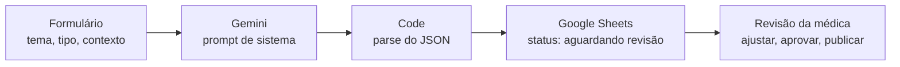

# Gerador de Roteiros de Reels com IA (n8n + Gemini)

Automação que transforma um tema de genética médica em um **rascunho completo de Reels** (roteiro, legenda, sugestões de edição e pontos para revisão médica) no tom do perfil de uma médica geneticista, e organiza tudo numa planilha para revisão.

Construído a partir de um problema real do meu trabalho: desde 2023 sou responsável pela comunicação digital da Dra. Sâmara Chebli, médica geneticista com atendimento online ([@drasamara.genetica](https://www.instagram.com/drasamara.genetica/)). Projeto publicado com autorização dela.

---

## O problema

Cada Reels do perfil passa por quatro etapas antes de ser gravado: escolher a pauta (datas de conscientização, notícias), pesquisar a condição, escrever roteiro e legenda, e revisar com a médica. Pela minha estimativa, isso leva de **3h30 a 6h do meu trabalho ativo por Reels**, e publicamos cerca de **2 Reels por semana**.

O recurso mais escasso do processo é o tempo da médica, que divide a agenda entre pacientes e família. Hoje, roteiro e legenda costumam ser construídos em conjunto, o que pode levar até um dia de espera.

## A solução

Um fluxo no n8n em que eu informo o tema e o tipo de vídeo num formulário. A API do Gemini gera um rascunho no estilo do perfil, e o resultado entra numa planilha com o status **"aguardando revisão médica"**.

A médica deixa de ser coautora do texto desde o zero e passa a ser **revisora** de um rascunho que já segue a estrutura e o tom dos vídeos dela.

> **A IA não substitui a médica.** Ela gera um rascunho fiel ao estilo do perfil, e a revisão humana continua sendo a etapa que garante precisão e sensibilidade. O ganho está em revisar em vez de escrever do zero.

## Como funciona

| Bloco | O que faz |
|---|---|
| **Formulário (n8n Form Trigger)** | Porta de entrada. Recebe `tema`, `tipo` (didático, campanha ou institucional), `contexto` opcional (data ou notícia) e `observacoes`. |
| **Gemini (Message a model)** | Envia o pedido para a API do Gemini 3.8 Flash com um prompt de sistema detalhado e exige a resposta em JSON. Tenta de novo automaticamente em caso de instabilidade da API (até 3 tentativas, 5 s de intervalo). |
| **Code (JavaScript)** | A IA devolve o JSON como texto. Este bloco remove possíveis marcações de código e faz o `JSON.parse`, separando cada parte em campos. |
| **Google Sheets (Append row)** | Grava uma linha por conteúdo: data, tema, tipo, contexto, título, roteiro, legenda, textos de tela, sugestões visuais, hashtags, pontos de revisão e status. |

### O que a IA entrega em cada rascunho

- **Roteiro** para ser falado, com 110 a 160 palavras (45 a 70 segundos)
- **Legenda** em três blocos, no padrão do perfil
- **Textos de tela** e **sugestões visuais** para a edição
- **Hashtags** opcionais
- **Pontos para revisão médica**: números, genes, sinais, tratamentos e expressões sensíveis que a médica precisa conferir

## Engenharia de prompt

O prompt de sistema ([ver no fluxo](gerador-de-roteiros-reels.json)) foi construído e refinado em etapas:

1. **Análise de 6 Reels reais do perfil.** Extraí os quadros dos vídeos e li as legendas embutidas para reconstruir as falas. Daí saíram três estruturas de vídeo: **didático** (uma condição), **campanha** (data de conscientização ou dor emocional) e **institucional** (o serviço e quem deve procurar).
2. **Regras de linguagem médica.** Linguagem cuidadosa ("pode", "costuma"), sem promessa de cura, sem diagnóstico, sem citar medicamentos, números apenas quando bem estabelecidos e em faixa quando a literatura usa faixa.
3. **Testes e correções.** Cada rodada de testes revelou problemas que viraram regras:

| Problema encontrado no teste | Regra adicionada |
|---|---|
| "Isso pode ser síndrome de Turner", soando como diagnóstico | Nome da condição em frase neutra e isolada |
| "A menina costuma ser muito esperta e ativa" | Proibido generalizar inteligência, comportamento ou aparência |
| "Me chama no link da bio", canal inventado | Proibido citar canais não informados |
| "Hoje, dia 21 de março", assumindo a data de publicação | Datas sem "hoje", a menos que informado |
| "Aperto no peito" num vídeo sobre câncer de mama | Proibidas expressões que lembrem sintomas da própria condição |

4. **Exemplos reais (few-shot).** A versão final inclui roteiros e legendas reais aprovados pela médica, com a instrução de usar apenas o tom e a estrutura, nunca copiar frases. Na comparação com um vídeo já publicado, o rascunho reproduziu a estrutura e o tamanho; a diferença ficou na criatividade das expressões, que continua sendo papel humano.

## Revisão humana: a etapa que garante a qualidade

Nos testes, a própria IA listou bem os pontos factuais para conferência (números, genes, critérios), mas **não identificou problemas de tom**. Exemplos reais encontrados só na revisão humana:

- A generalização "muito esperta e ativa" sobre meninas com síndrome de Turner
- "Aperto no peito" num vídeo sobre câncer de mama
- "Uma pergunta sem nome": uma expressão com cara de boa, mas que não faz sentido (o que não tem nome é a doença, não a pergunta)

Por isso, todo conteúdo entra na planilha como **"aguardando revisão médica"**, e o status só muda para "aprovado" ou "publicado" depois da revisão.

## Resultado medido

> ⏳ **Em medição.** Os números abaixo serão preenchidos com o tempo cronometrado em Reels reais produzidos com a automação.

**Método:** em cada Reels produzido com a automação, cronometrei cada etapa separadamente e registrei numa aba da planilha. O "antes" é a minha estimativa do processo anterior; o "depois" é cronometrado.

| Etapa | Antes (estimativa) | Depois (média cronometrada) |
|---|---|---|
| Escolher a pauta | 30 min a 1h | ⏳ |
| Formulário + resposta da IA | não existia | ⏳ |
| Pesquisa / conferência dos pontos de revisão | 1h a 2h | ⏳ |
| Roteiro e legenda / ajuste do rascunho | 2h a 3h | ⏳ |
| **Total do meu trabalho por Reels** | **3h30 a 6h** | **⏳** |
| Revisão da médica | ⏳ | ⏳ |

**Economia estimada:** ⏳ horas por semana (com 2 Reels por semana), considerando ⏳ Reels medidos.

## Ferramentas

- **n8n** (n8n Cloud): orquestração do fluxo
- **Google Gemini API** (Gemini 3.8 Flash, plano gratuito): geração do texto
- **Google Sheets**: armazenamento e controle de status da revisão
- **JavaScript**: tratamento da resposta da IA
- **Google AI Studio**: testes e refinamento do prompt

## Como importar e usar

1. No n8n, crie um fluxo novo e importe o arquivo `gerador-de-roteiros-reels.json` (menu **…** > **Import from File**).
2. Crie uma credencial do **Google Gemini** com a sua própria chave do [Google AI Studio](https://aistudio.google.com/) e selecione-a no bloco do Gemini.
3. Crie uma planilha com estes cabeçalhos na primeira linha:
   `data | tema | tipo | contexto | titulo | roteiro | legenda | textos_de_tela | sugestoes_visuais | hashtags_sugeridas | pontos_revisao | status`
4. No bloco do Google Sheets, conecte sua conta Google, troque `COLE_AQUI_O_ID_DA_SUA_PLANILHA` pelo ID da sua planilha e `NOME_DA_ABA` pelo nome da aba.
5. Publique o fluxo e use a **Production URL** do formulário.

## Segurança

- Nenhuma chave de API está neste repositório. As credenciais ficam guardadas apenas no n8n.
- O arquivo exportado foi limpo antes da publicação: sem IDs de credenciais, sem ID da planilha original e sem o endereço do formulário de produção.
- Nenhum dado de paciente passa pelo fluxo: a entrada é apenas o tema educativo do vídeo.

## Próximos passos

- Calendário de datas de conscientização na planilha, para sugerir pautas automaticamente
- Busca de notícias recentes sobre o tema, como contexto para a IA
- Novos formatos além de Reels (carrossel e post estático)
- Gerar automaticamente o arquivo de legenda do vídeo a partir do áudio gravado

---

**Wesley Lima** · Comunicador em transição para desenvolvimento e IA
[LinkedIn](https://linkedin.com/in/wezeley) · [GitHub](https://github.com/wezeley)
